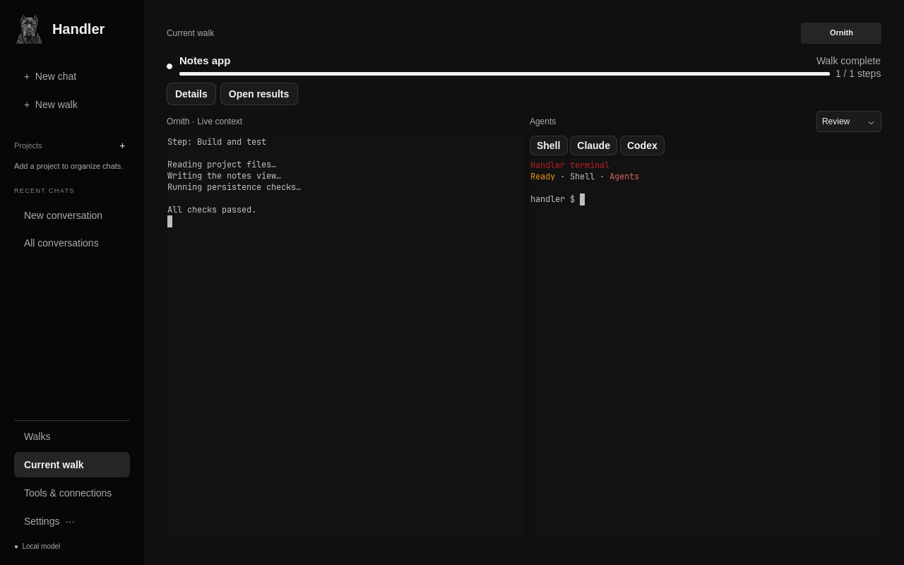
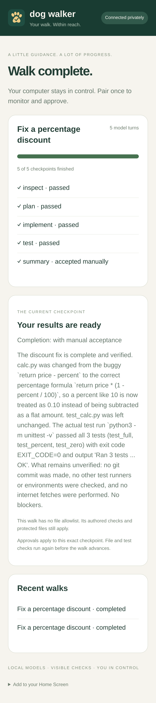

# Handler

Previously Dog Walk. Existing `dog-walker` commands, `.dogwalk` forms and saved work remain compatible.

Handler is a local AI workspace for chat, pictures, and real work. Discuss a task with your model, attach reference files, and turn the conversation into a reviewed work plan. The same `.dogwalk` form validator and workflow engine handle plans made in chat or imported from another agent. Each walk follows authored steps, checks actual files and tool results, and pauses for your review when needed. **Main-model inference stays local, with no cloud fallback. Optional connectors can access external services when a plan grants them. Optional Jev decision routing requires a separate opt-in and is disabled by default.**

Version 0.4 is a source-install preview. The native frontend uses **QML + Quickshell**, with saved dark/light black-and-white themes, project sidebar and cropped-ear Cane Corso portrait. The workflow engine and local Laya inference stay in Python. The optional phone companion follows the selected walk over private Tailscale HTTPS. Existing `dog-walker` commands, settings paths, inbox, saved runs, `.dogwalk` forms, and phone pairing remain compatible.



## Start

Walks with **Project tools** can now map the project and search relevant code
before editing, without extra setup. See [project context](docs/PROJECT_CONTEXT.md).
The small coder has been removed. Its [comparison](docs/BENCHMARK.md) remains
available as a historical record. See [model and speed guidance](docs/MODEL_STRATEGY.md).

Opening a walk shows the local model's **Live context on the left** and
**Agents on the right**. Click **Shell**, **Claude** or **Codex** on the right;
switching agent tabs keeps the model's context visible. **Review** is the default;
**Help** pauses before scoped repairs. Both panes use your current Omarchy terminal
colors and font. See [terminal helpers](docs/HELPERS.md).

Choose **Qwen 3.8 27B**, **Ornith**, or **Gemma 4** in the chat header or New walk model picker. Qwen uses the installed dense 27B model. The next request loads that model; the shared launcher keeps one main model active and refuses to stop a busy server. Advanced connection settings are folded away in Settings.

Open **Handler** from your application menu, or type:

```sh
dog-walker
```

This opens the native desktop app. The installed shortcut on the development Omarchy machine is **Super + Alt + D**; the portable installer does not override other people's keybindings.

1. Start in **Chat**. Choose a project and describe the work. Press **Enter** to send and **Shift+Enter** for a new line. Use **Attach** or drop files on the composer: PNG/JPEG/WebP pictures go through vision, UTF-8 files provide text context, and readable PDFs provide extracted text. Conversations and attachment snapshots are saved locally.
2. Choose **Tools** for the next plan, then **Create a walk**. The model asks for missing details or produces the official form. Click **Review plan**. For a fresh task, open **New walk**, drop any `.md` file into the message box or use **Attach file**, then click the folder icon **Project** to choose where to work. The chooser starts in your Projects area. **Create walk** turns the brief into the same validated plan; it can ask a question before producing it. The folder is always your choice. You can also attach [forms prepared by another agent](forms/AGENT_HANDOFF.md); the inbox remains `~/Documents/Dog Walker/Inbox`.
3. Review allowed files, steps, plugin access, and verification commands. **Protected copy** copies the project into a separate workspace and prepares local Git history. **Current folder** edits the selected files and adds local history if needed.
4. Press **Start walk**. Auto walk advances checked steps and uses bounded corrections. It still stops for explicit approvals, uncertainty, blockers, and exhausted retries.
5. Use **Approve & continue**, **Retry step**, or **Pause walk** when needed. **Walks** holds saved runs. **Open results** opens the resulting workspace; **Discuss in chat** supplies a snapshot of the actual status, results, and checks to your conversation. Pause an active walk before using the model for chat.

The sidebar's **Settings ···** menu contains light/dark mode, model settings, Help, the Inbox and Phone companion. **Projects +** adds an existing project folder and groups its chats. Attaching a brief never executes work. Plain Markdown uses the selected local model to prepare a plan; a completed official form requires no planning conversation. Markdown attachments can be up to 256 KB; local planning currently accepts briefs under 48 KB. Starting installs a protected reference copy for the worker and retains the original brief. See [chat and attachment details](docs/CHAT.md), [plugins](docs/PLUGINS.md), [installed Firecrawl/browser connectors](docs/CONNECTORS.md), [model loading](docs/RUNTIME.md), and [logo provenance](docs/LOGO.md). For a practice walk with approvals before edits and after testing, use [the phone-flow test form](examples/phone-flow-test.dogwalk) with a copy of `examples/fixture`.

Importing or depositing a job never executes it. A job can contain powerful commands, so only start forms you trust. Protected copy preserves the selected folder, including its existing Git history, by working in an independent copy. It is not a security boundary.

New official forms declare `allowed_changes`, an exact file allowlist. Handler fingerprints tracked and non-ignored files, independently detects persistent scope drift, and prevents advancement while that gate fails. Ignored files and files outside the workspace are not monitored by this gate. Older forms without an allowlist retain their authored checks but do not have this additional scope protection. Handler prepares the local Git baseline automatically, including when an ordinary folder uses an allowlist.

Approval applies to the exact run and review request, and deterministic checks run again before advancement. A stale or duplicate decision is rejected. Pausing during verification kills the running command group and waits for its exit before releasing the run lock.

## Phone companion

Once installed, turn on Tailscale on both devices, open **Settings ··· → Phone companion** in the desktop, and visit its private HTTPS address on your phone. Enter the pairing code shown on the computer, then use **Add to Home Screen** in Safari or **Install app** in Android's browser. Monitor the current step and evidence, approve or retry a review, pause, and resume. Keep the computer awake and Handler open while a walk runs; closing the desktop pauses its worker.

To install the optional companion on a machine with Tailscale already connected:

```sh
.venv/bin/python scripts/setup-phone.py
```

The setup adds a user service on loopback port 18190 and a private Tailscale Serve HTTPS route. It refuses to replace unrelated Serve routes and never enables Funnel. See [Tailscale Serve](https://tailscale.com/docs/features/tailscale-serve) for the private HTTPS mechanism. No project data is hosted by this app in a cloud backend. Phone monitoring itself needs a network connection; the coding engine's hard offline acceptance remains a separate test.

Access requires the configured Tailscale owner identity plus pairing. Signed cookies are Secure, HttpOnly, and SameSite=Strict, expire after 12 hours, and actions require an origin check, CSRF token, exact run ID, and fresh review ID. Only trusted local users should have access to the computer. The app shell can open offline, but status and approval APIs are never cached and offline actions are disabled rather than queued. [PWA installation guidance](https://developer.mozilla.org/en-US/docs/Web/Progressive_web_apps/Guides/Making_PWAs_installable).

The companion passes Chromium mobile emulation for iPhone and Android; this is not a claim that physical iOS Safari or every phone/browser has been tested. The prototype controls the current native desktop walk. Terminal-only walks and closing the desktop are not a headless remote-worker service.



Current verification: **470 Python tests passed in the latest full suite**, plus **32 Qt test results** including real terminal keyboard input. Coverage includes independently chosen project folders, protected briefs, persistent separate context/agent PTYs, agent restoration without inference, Omarchy color imports and pause-before-helper-edit behavior. The two-pane layout renders at 1280×800 and 720×400 in both interface modes. Earlier checks include actual project-map tool receipts, browser/phone actions, and a three-turn real-model desktop walk with phone approval and reopen without replay. See [the verification record](VERIFICATION.md) for evidence and limits.

The [six-task helper pilot](docs/BENCHMARK.md) is retained as historical evidence. The small coder was removed at Rick's request; local Laya remains available.

To stop phone access, stop `dog-walker-phone.service` and remove only its Serve route with `tailscale serve --https=443 off`. To revoke existing paired sessions, stop that service, delete the private `phone-secret.json` from the app's data directory, and restart it; the new code appears in the desktop panel. Preserve saved runs.

The [official schema](forms/job.schema.json) is versioned, rejects unknown fields, and supports inline prompts, acceptance criteria, authored corrections, file/test checks, and optional local-judge questions. [A completed discount-repair example](examples/discount.dogwalk) targets `examples/fixture`; it is not a plan for arbitrary projects. Plain-text form prompts treat dollar signs literally. Written success criteria are instructions, not automated proof; steps without reliable checks require human review.

The terminal interface remains available with `dog-walker demo`. It opens a disposable five-step coding demo: inspect → plan → implement → test → summarize. The first prompt can take a few minutes on a CPU; later turns reuse the same session and model cache.

The final demo checkpoint asks the local judge about completion. Laya may ask for review even when the tests pass; examine the evidence and press **Approve** to accept it. This choice is recorded as manual acceptance. Automatic mode still pauses on uncertainty, blockers, interrupted tools, missing evidence, or exhausted retries.

Other commands:

```sh
dog-walker demo --auto                  # Dashboard, automatic checked steps
dog-walker demo --auto --plain          # Plain output; uncertainty pauses when no terminal input is available
dog-walker new ~/Projects/my-walk       # Create an editable workflow folder
dog-walker validate ~/Projects/my-walk
dog-walker run ~/Projects/my-walk --root /path/to/project
dog-walker runs
dog-walker resume RUN_ID
dog-walker doctor --offline
dog-walker validate-form examples/discount.dogwalk
dog-walker desktop /path/to/completed-job.dogwalk
```

Normally Handler copies the current project files into a private workspace and creates a local starting commit. Existing Git metadata, hooks, and remotes are excluded from that copy. Ordinary folders, empty projects, and projects with uncommitted work are supported; the original folder stays unchanged. Use `--in-place` explicitly to edit selected files directly; missing local Git history is prepared automatically. The app never creates a GitHub repository, adds a remote, or pushes a project. Worker and verification commands run with network access disabled. The initial local commit is a baseline, not publication of the finished work. Review and copy or merge wanted edits yourself.

## Write your prompt sequence

`dog-walker new FOLDER` creates a starting prompt, correction prompt, and `workflow.yaml`. Edit them in your editor. Add one Markdown file for each step. Here is a short workflow:

```yaml
version: 1
name: Repair my project
entry: inspect
max_turns: 12
steps:
  - id: inspect
    prompt: steps/01-inspect.md
    retry_prompt: retries/inspect.md
    max_retries: 2
    checks:
      - {id: no-edits-yet, type: no_changes}
      - {id: read-source, type: response_contains, text: app.py}
  - id: implement
    prompt: steps/02-implement.md
    retry_prompt: retries/implement.md
    checks:
      - {id: tests-not-rewritten, type: unchanged, path: test_app.py}
      - id: real-tests-pass
        type: command
        argv: [python3, -m, unittest, -v]
        timeout: 60
```

Steps advance in listed order by default. `on_pass` can name another step, `complete`, or `pause`. `on_exhausted` defaults to `pause` and can name a recovery step. A global turn limit stops circular workflows. `approval: true` always requires your approval, including in automatic mode. `timeout` defaults to 1800 seconds per worker turn. Two correction attempts are allowed by default, for three attempts total.

Available Markdown substitutions are `${project_root}`, `${step_id}`, `${previous_result}`, and `${failed_checks}`. Write `$$` for a literal dollar sign, including shell variable examples. Unknown substitutions and paths outside the workflow folder are rejected.

Deterministic check types:

| Type | Configuration | What it checks |
| --- | --- | --- |
| `command` | `argv`, optional `timeout` | Executes the authored verification command and requires exit 0 |
| `unchanged` | `path` | File checksum matches the start of the run |
| `file_exists` | `path` | Required file exists in the workspace |
| `file_contains` | `path`, `text` | Actual file contains the required text |
| `response_contains` | `text` | Structured worker result contains the text |
| `command_executed` | `text` | A recorded worker command containing this text exited 0 |
| `tool_called` | `tool` | A successful built-in plugin receipt exists for the current step and turn |
| `no_changes` | none | Git reports no tracked or untracked changes, except ignored files |

Author verification commands for your project; a semantic judge cannot prove code works. Commands run as argument arrays within the selected workspace. Choose test tools that are already installed for offline use. Review workflow files before running them because verification commands execute locally.

Optional semantic questions use the local Laya model:

```yaml
    questions:
      ready:
        type: noul
        instructions: Does this agent trace report successful completion of the work?
        expected: true
        threshold: 0.85
```

`noul` checks a true/false statement. `choice` accepts a named `criteria` mapping and `expected` label. `score` accepts an ordered `criteria` list and `minimum` index. Choice/score gates use probability mass on the expected label or permitted score range. Values between the pass and fail thresholds require review. A semantic-only checkpoint always requires human review. A semantic answer cannot override failed files, tests, protected-file checks, or a blocked worker result.

Every turn returns a validated `StepResult`: `status`, `summary`, `evidence`, `files_changed`, and `blockers`. Claims inside that result are evaluated against captured tool events and the authored checks. Laya receives only the short result and check statuses. Overlong or truncated judge input requires review.

## Optional plugin harness

Jobs may request `plugins: [project, browser, obsidian]` to expose named project,
browser-inspection and connected-vault tools through MCP. Read full plan shows
the requested plugins and settings before Start. Existing forms that omit the
field retain their original tool set. Each run snapshots its grants and logs
calls; `tool_called` checks a successful built-in call from the current step/turn.
Laya's optional `recommend_tool` suggests an enabled tool name or reports
uncertainty; the worker supplies arguments and executes the call.

Use `dog-walker plugins` to list plugins and `dog-walker plugin-add MANIFEST.json`
to install a trusted stdio MCP manifest or configure a built-in adapter without
starting it. Browser origins are empty by default; Obsidian reads the existing
vault only. Configured external tools can use permitted network resources while
inference stays local. See [the plugin guide](docs/PLUGINS.md) for setup, boundaries
and the [read-only practice form](examples/plugin-harness.dogwalk). Interactive
browser actions, direct OAuth management, an in-app plugin catalog and real-model
routing accuracy are not yet verified.

## Offline operation and recovery

After setup, the workflow runner, local judge, and model inference require no internet connection. Model requests go to the configured loopback endpoint (the initial profile uses `127.0.0.1:18081`). The judge loads verified local files with Hugging Face and Transformers offline modes enabled. Codex uses its own local provider configuration with cloud apps, web tools, hooks, telemetry, and plugins disabled. Worker tools use the workspace sandbox with network access explicitly disabled. Authored verification commands also use the installed Codex workspace sandbox; they fail closed if it is unavailable. Model requests remain loopback, and phone monitoring uses a separate private service. The app does not change system-wide network settings. See [offline/security boundaries](SECURITY.md).

There is an important measured limitation: on the initial 32-case authored synthetic diagnostic, the completion question returned **28 reviews, 4 negative decisions, and no automatic positive decisions** at the conservative 0.85 threshold. There were zero false passes in that small set, but that does not establish general accuracy. Laya is currently helpful as a review gate, not a sole autonomous judge for coding. Workflow-specific tests and file checks provide the strongest automatic checkpoints. We have not tuned thresholds merely to make the demo pass.

**Pause** or `Ctrl+C` stops the running turn and retains partial edits. **Abort** retains files but ends the run. **Retry** uses your correction prompt, and **Edit** lets you replace the next retry prompt. **Skip** is explicit and is recorded; a run with skipped steps is not reported as all steps passing.

When reopening a reviewed step, Handler reruns its checks without resending the completed prompt. An interrupted turn instead needs an explicit retry, because its commands might already have modified files. One lock prevents two walkers from running the same saved run concurrently.

Run data lives at `~/.local/share/dog-walker/runs/RUN_ID/`. Each run holds the copied workflow, event log, snapshots, result files, and workspace. Logs are private local files and redact common credential patterns; they may still contain your project text. The isolated Codex state is in `~/.local/share/dog-walker/codex-home/` and the pinned judge is under `~/.local/share/dog-walker/judge/`. Nothing is written to Obsidian automatically by the app.

## Installation and verification

Prerequisites: Linux, Python 3.14+, Git, Quickshell with Qt Quick Controls/Dialogs, Codex CLI (tested 0.162.0), and a downloaded local model with a compatible llama.cpp **Responses API** server. The installer does not install Codex or a large worker model for you. Ollama/chat-completions-only servers are not a drop-in replacement for this coding harness. CPU dependencies below were recorded on x86-64 Omarchy.

Clone this repository, then install the environment and desktop integration:

```sh
git clone https://github.com/rickndanger-ctrl/dog-walker.git
cd dog-walker
./scripts/install.sh
```

The install downloads software and the small judge checkpoint once. `dog-walker setup-local-judge` verifies the large weight file against the source's SHA-256 and records checksums for every pinned artifact. There are no runtime model downloads. Source: [Laya](https://github.com/NandhaKishorM/laya), checkpoint `convaiinnovations/laya-typed-decisions` at `e929ae5cf69bc34259cd2f95c9e91145b818b1f0`, Apache 2.0. Dependency and model licenses are separate from this app's MIT license; weights are not redistributed here. Codex tool/event integration follows [the non-interactive documentation](https://learn.chatgpt.com/docs/non-interactive-mode) and the installed CLI's actual options.

On a new machine, open **Local model settings** and set the GGUF file, loopback `/v1` endpoint, model catalog, and optional launcher. Saved settings live in `~/.config/dog-walker/worker.json`; they are never embedded in job forms. Empty launcher means use an already-running server. The endpoint must identify the selected model through `/props`. The default profile matches the original Ornith setup; other machines must supply their own paths and server. Python-only package installation is not a standalone desktop distribution: run from this source checkout with its `native/`, `forms/`, and `examples/` folders intact.

The [optional Omarchy widget](omarchy-plugin/README.md) is a quick launcher, not an official Omarchy package. Existing shell and desktop files under `/usr/share/omarchy` are not modified.

```sh
.venv/bin/python -m pytest -q
unshare -Urn .venv/bin/python scripts/evaluate_judge.py
unshare -Urn .venv/bin/python scripts/offline_acceptance.py
# Optional: rendered desktop + real worker, using your running local server
.venv/bin/python scripts/desktop_acceptance.py
# Includes a paired HTTP approval through the real QML desktop broker
.venv/bin/python scripts/desktop_acceptance.py --phone --plain-project
# Optional browser checks: install Playwright separately for this harness
node scripts/phone_acceptance.cjs
```

The acceptance script runs Ornith, Codex tools, and Handler inside a network namespace with loopback only, confirms that connecting to an external IP fails, and drives the actual coding fixture. Its report is in `artifacts/offline-acceptance.json`. If the final semantic gate pauses, `scripts/offline_acceptance.py --resume RUN_ID` provides a separately recorded **scripted test approval** after verified checks pass and asserts that no completed worker turn was replayed. This test-only approval is never part of the application.

The separate desktop acceptance harness renders a temporary copy of the actual QML interface, imports the official completed example, invokes its Start/Pause/Resume/Approve button handlers, and checks a real Ornith job plus reopen without replay. It uses isolated disposable run data and an already-running loopback server. Its final approval is explicitly scripted for testing; this harness does not disable the host's external network. Private artifacts and model weights are excluded from Git. Selected verification summaries are in [docs/verification](docs/verification/).

To remove the application later, remove its launcher and project environment. Preserve the data folder if you want saved runs. New protected workspaces are independent local copies and can be removed after saving wanted edits. Older saved runs may use Git worktrees; remove those using Git from their source repositories.
